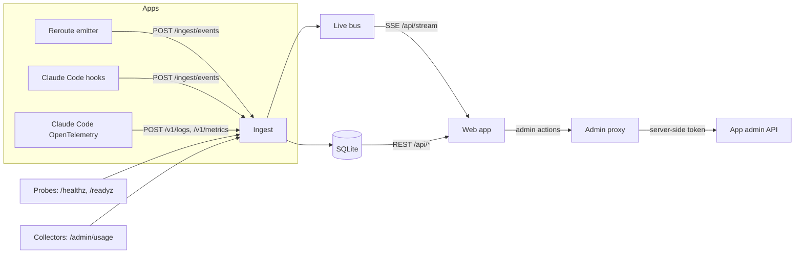

# Mycelium architecture

Mycelium is a monitoring hub for several apps at once. It shows status, uptime, costs, usage and API calls for each app and for all apps combined, lets the owner manage an app's access from one place, and draws a live, Obsidian-style map of every file, data store, endpoint and external API, with a pulse running along a line each time Claude or the app reads or writes something.

Reroute is the first app. Nothing here is Reroute-specific: an app is connected by giving it an ingest key and, optionally, an admin endpoint.

**Status:** spec, 2026-10-30. Written with Claude Code; needs human review.

## Principles

- **Same feel as Reroute.** React, Vite and framer-motion, with Reroute's `choreography.js` timings and its "Night Dispatcher" tokens (dark first, Inter, ease-out only, leaving faster than arriving, transform and opacity only, reduced motion honoured).
- **Small and boring back end.** Flask, SQLite (WAL) and server-sent events. One process is enough for one owner and a handful of apps.
- **Extensible by registration.** A new feature is one collector on the server and one panel in the web app (see [Adding a feature](#adding-a-feature)).
- **Private by default.** The repository is public; the running site is not (see [Security](#security)).
- **Never store content or secrets.** Events carry paths, sizes, timings and counts, never file contents, request bodies, tokens or personal data.

## Concepts

| Term | Meaning |
|---|---|
| App | A monitored application: slug, name, base URL, repository root, ingest key (stored hashed), optional admin URL and admin token (server-side env, never sent to the browser). |
| Source | Who produced an event: `app` (the app's own emitter), `claude` (Claude Code hooks and telemetry), `probe` (Mycelium's own checks), `collector` (data Mycelium pulls). |
| Node | Something on the map. Kinds: `file`, `store` (database, cache file), `endpoint` (HTTP route), `external` (third-party API), `actor` (Claude, a user group, the app process). Id is `kind:path`, for example `file:apps/plan-b-mvp/rides.py` or `store:data/rides.sqlite3`. |
| Edge | A relation between two nodes. Static edges come from the code graph (imports, calls); runtime edges come from events (`rides.py` writes `rides.sqlite3`). |
| Event | One thing that happened, in the format below. |

## Event format

```json
{
  "ts": "2026-10-30T07:39:34.120Z",
  "app": "reroute",
  "source": "app",
  "kind": "write",
  "actor": "actor:app",
  "node": "file:apps/plan-b-mvp/rides.py",
  "target": "store:data/rides.sqlite3",
  "status": "ok",
  "duration_ms": 3.2,
  "bytes": 412,
  "usd": 0,
  "meta": {"op": "report"}
}
```

`kind` is one of `request`, `read`, `write`, `external`, `probe`, `cost`, `admin`, `log`. Unknown fields go in `meta` (at most 2 KB). The server rejects events with a `ts` more than 10 minutes in the future and stamps its own receive time.

## Data flow



### Getting data in

- **App emitter.** A single small module per app that queues events and posts them in batches (every 2 s or 200 events) with `Authorization: Bearer <ingest key>`. It never blocks a request, and drops events if Mycelium is down. For Reroute it hooks `before_request` and `after_request`, `google_api.record_request` (every billable call), the one fetch helper of each external API, and the read and write functions of the six data stores (`rides.sqlite3`, `accounts.db`, `push.json`, GTFS `index.json`, OSM cache, `vapid.json` reads as a name only).
- **Claude Code hooks.** A `PostToolUse` hook for `Read`, `Edit`, `Write`, `NotebookEdit`, `Glob` and `Grep` sends the tool name and the file path, relative to the repository it belongs to. Paths outside a registered app's repository root are dropped on the client, so nothing else on the computer is reported.
- **Claude Code telemetry.** Claude Code's OpenTelemetry export (OTLP over HTTP, JSON) gives token use, cost, sessions and API requests. Mycelium accepts the OTLP logs and metrics endpoints directly; the ingest key goes in `OTEL_EXPORTER_OTLP_HEADERS`.
- **Probes.** Mycelium checks each app's health URL every 60 s and readiness URL every 5 min, recording status code and latency. Uptime is computed from these.
- **Collectors.** Pull data an app already exposes, for example Reroute's `/admin/usage` (Google API cost estimates) every 5 min, using the admin token held in Mycelium's environment.

### Storage

SQLite in WAL mode, one file. Tables: `apps`, `events` (raw, kept 30 days), `rollups` (per app, per hour and per day: requests, errors, p50 and p95 latency, reads, writes, external calls, cost; kept forever), `probes`, `nodes`, `edges`, `audit` (every admin action), `settings`. An hourly job rolls up and prunes.

### Live stream

`GET /api/stream?app=<slug>` is a server-sent event stream. The ingest step publishes each accepted event to an in-memory bus; each connected browser gets the events for the apps it watches, at most 50 per second (extra events are counted, not sent).

## The map

- **Base graph.** Built from the app's repository with graphify (local AST parsing only, no LLM step): files and their imports and calls. Mycelium stores it as `nodes` and `edges` and refreshes it on demand or when the app's commit changes.
- **Runtime layer.** Each event adds or updates nodes and runtime edges, so data stores, endpoints and external APIs appear as soon as they are used.
- **Rendering.** `force-graph` on a canvas: d3-force layout, zoom and pan, nodes sized by activity, clusters coloured by folder. Each live event calls `emitParticle` on its edge; the colour shows the kind (read teal, write indigo, external orange, error red) and the particle speed follows the choreography tokens. Reduced motion replaces moving particles with a brief highlight of the edge.
- **Interaction.** Search, focus a node and its neighbours, filter by kind or source, a time scrubber to replay the last hour, and click-through to a node's history.
- **Accessible alternative.** A table view with the same nodes, edges and recent activity, keyboard navigation of the graph (arrow keys move between neighbours, Enter opens details), and a polite live region that summarises activity every 10 s rather than per event.

## Views

| View | Shows |
|---|---|
| Overview | Combined status of all apps, total cost today and this month, requests, errors, uptime, top changes. |
| App switcher | Command palette (Ctrl+K) and a sidebar list; the current app is in the URL. |
| Status and uptime | Current health, 90-day uptime bars, incidents, probe latency. |
| Costs | Cost per API and per day, Claude cost per session, projections against caps and budgets. |
| Usage | Requests per route, active installs (counted, not identified), feature use. |
| API details | Every external API: calls, errors, latency, cache hit rate, daily cap use. |
| Transactions | Billable API calls as a ledger now; payment providers later. |
| Live map | The graph above. |
| Event log | Filterable, live-tailing list of events. |
| Access | Admin actions for the app (below). |
| Settings | Apps, keys, budgets, alert rules. |

## Access management

Mycelium proxies admin actions to the app's own admin API; the admin token never leaves the server. Every action is written to `audit` with who, what and the response. For Reroute this starts with what already exists (moderation queue, approve, remove, ban, unban) and adds, in Reroute, admin endpoints for: reading and changing rate limits and daily caps at runtime, switching sign-in on or off, the ride board on or off, and revoking a user's sessions.

## Security

- **Running site is private.** Served through `tailscale serve` (tailnet only), not Funnel. The owner signs in; v1 trusts Tailscale's identity headers on the tailnet and adds a password fallback for local development.
- **Ingest keys** are random, shown once, stored as hashes, and scoped to one app. Ingest is rate-limited per key.
- **Admin tokens** for apps are environment variables on the Mycelium server, never stored in SQLite or sent to the browser.
- **No content.** Events carry metadata only; the hook and emitters strip query strings, bodies and personal data. Client addresses are not stored.
- **CSRF and headers.** Same-origin only, strict CSP, SameSite cookies, the same header set as Reroute.

## Back end as built (step 4, 2026-10-31)

- `server/db.py` schema and helpers; `server/api/ingest.py` (`POST /ingest/events`, key in `Authorization: Bearer`, max 500 events per batch, 6000 events per key per minute, the app always comes from the key); `server/bus.py` and `server/api/stream.py` (`GET /api/stream?app=`, 50 events per second per client, a `dropped` event reports the count).
- `server/collectors/`: `probes.py` (health 60 s, readiness 5 min) and `reroute_usage.py` (5 min; token from env `MYCELIUM_ADMIN_TOKEN_<SLUG>`). A scheduler thread runs them and the hourly job; set `MYCELIUM_SCHEDULER=0` to disable.
- Register an app with `python manage.py add-app <slug> <name> --health-url ...`; it prints the ingest key once. Database path: `MYCELIUM_DB` (default `server/data/mycelium.sqlite3`).
- Not built yet: the read API for the web app (`/api/apps`, rollups, probes), owner login, OTLP endpoints (step 5).

## Adding a feature

- **Server:** a collector is a module in `server/collectors/` that registers `name`, `interval` and `run(app)`; it returns events or rollup rows. A panel's data comes from `server/api/<feature>.py`.
- **Web:** a panel is a module in `web/src/panels/` that exports `id`, `title`, `icon`, `requires` (the capabilities an app must have, for example `admin` or `costs`) and a component. The sidebar and command palette list panels automatically, and hide panels an app can't support.

## Multi-user later

Kept in mind, not built in v1: organisations that own apps, members with roles (owner, admin, viewer), email or OAuth sign-in, per-organisation ingest keys and quotas, and public onboarding (an emitter package per language and a Claude Code hook installer). The v1 tables already carry an `app` key everywhere, so adding an `org` column is a migration, not a rewrite.

## Repository layout

```
server/            Flask app: ingest, api, stream, probes, collectors, admin proxy
web/               React + Vite app (design tokens and choreography ported from Reroute)
emitters/python/   Single-file emitter for Flask apps (Reroute uses this)
hooks/claude/      Claude Code hook script and settings snippet
infra/             Dockerfile and homelab notes
docs/              This spec and feature logs
```
